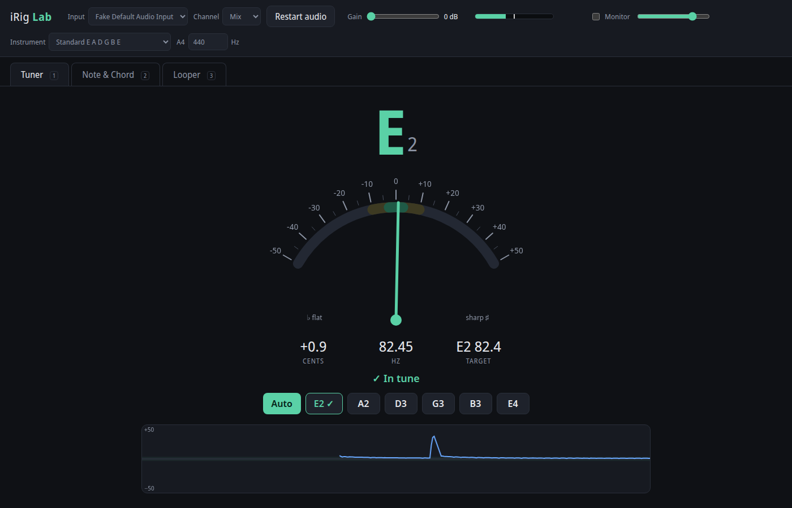
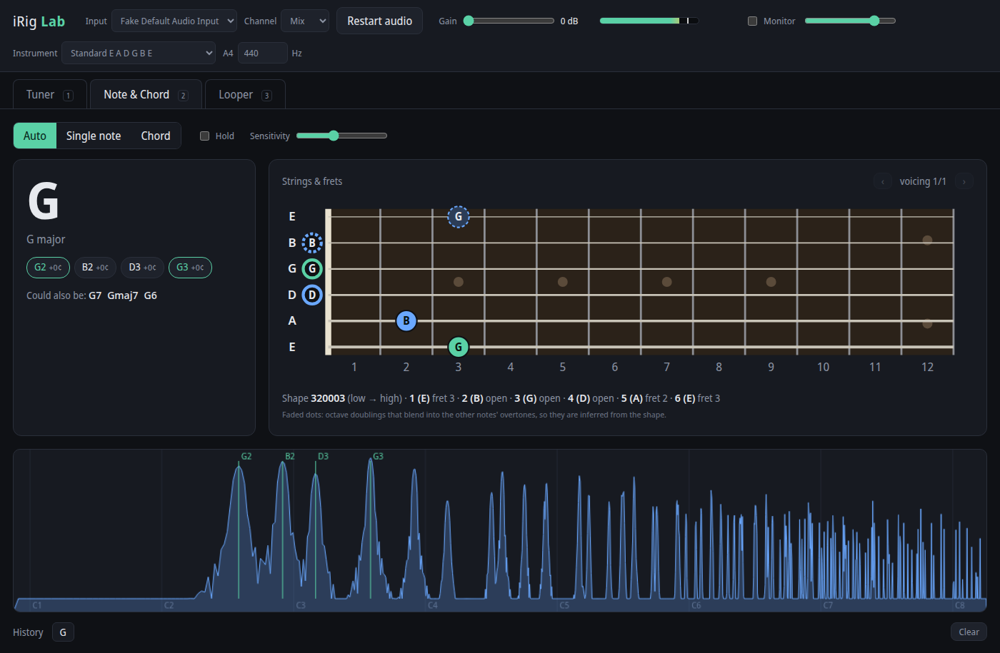
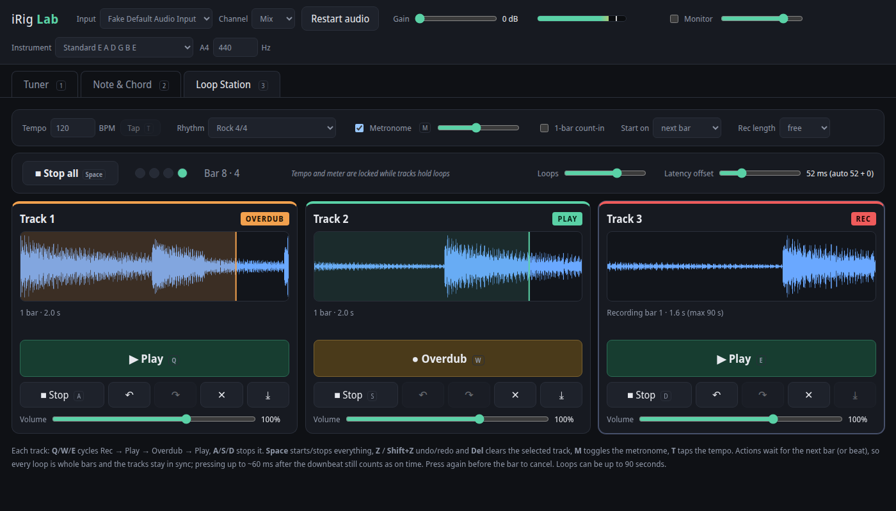

# iRig Lab

Tuner, note/chord analyzer and 3-track loop station for guitar or bass through an **IK Multimedia iRig HD**
(or any audio input). It runs in the browser with the Web Audio API and needs no build step
or dependencies.

**Try it online:**
- **Desktop:** [https://opivankristovi.github.io/TML-Tuner-Metronome-Looper/](https://opivankristovi.github.io/TML-Tuner-Metronome-Looper/)
- **Phone:** [https://opivankristovi.github.io/TML-Tuner-Metronome-Looper/mobile/](https://opivankristovi.github.io/TML-Tuner-Metronome-Looper/mobile/). Open it on an iPhone or Android phone and add it to the home screen.

The phone version ([`mobile/`](mobile/README.md)) is a touchscreen fork that installs as an app and works
with built-in, headset, USB (OTG) and Bluetooth microphones.

## Screenshots

**Tuner**: an E string, 0.9 cents sharp, counted as in tune.



**Note & Chord**: an open G chord named and laid out on the fretboard as `320003`.
Dashed dots are octave doublings inferred from the shape.



**Loop Station**: track 1 overdubbing, track 2 playing and track 3 recording, over a rock beat at 120 BPM.



The screenshots were captured from synthesized guitar signals.

## Run

The quickest way is the published page: [https://opivankristovi.github.io/TML-Tuner-Metronome-Looper/](https://opivankristovi.github.io/TML-Tuner-Metronome-Looper/), in Chromium, Chrome or Firefox.
Locally, with the iRig HD set up automatically:

```bash
./start.sh
```

The script switches the iRig HD's PipeWire profile to `pro-audio` (by default PipeWire leaves
it `off`, so it has no input). It then serves the folder on `http://localhost:8765` and opens
a Chromium app window. You can also run `python3 serve.py` and open `http://localhost:8765`
in any Chromium or Firefox browser. It must be `localhost`, because microphone access needs a
secure origin. `serve.py` also sends the cross-origin isolation headers that let the loop
station share its buffers between the audio thread and the UI; a plain static server works,
but waveforms and export then fall back to copying.

The first time, press **Start audio** and allow microphone access. The app picks the iRig
automatically when it's listed.

## Features

**Tuner** (key `1`)
- Chromatic tuner using the McLeod Pitch Method, accurate to about ±1 cent, from B0 (5-string bass) to E6.
- Needle gauge, cents/Hz readout, a 6-second drift graph, and a ✓ on each string once it has held in tune.
- **Auto** targets the nearest note. Click a string button to lock the target to that string; useful when it's far out of tune.
- Presets: standard, drop D, E♭, D standard, drop C, DADGAD, open G/D, 7-string; 4/5/6-string bass and drop D bass.
- Adjustable A4 reference (415–466 Hz).

**Note & Chord** (key `2`)
- **Single note**: name, octave and cents, plus every place on the neck where that note can be played.
- **Chord** (*experimental*): polyphonic detection finds the individual notes, names the chord
  (major, minor, 7ths, 6ths, sus, dim, aug, add9, 9ths, power chords, slash/inversions), and
  shows the most likely **strings and frets**. Use ‹ › to step through alternative voicings.
  It is most reliable with a clean signal (the iRig, or a mic close to the guitar). Through a
  room mic it usually gets the chord right but may miss or add a note, most often the bass.
- **Noise threshold**: only sound this far above the room's background (fans, hum) is analysed.
  The meter shows the input level, the background (grey mark) and the threshold (yellow mark),
  and says whether it is *Listening* or *Background ignored*. Raise it if background noise
  still shows notes; lower it if soft playing is missed.
- Spectrum view with the detected notes marked, and a history strip of what you played.
- **Hold** keeps the last result on screen. **Sensitivity** sets how weak a note can be and
  still count (higher means stricter, with fewer false notes).

**Loop Station** (key `3`)
- **Three tracks**, each with its own Rec / Play / Overdub / Stop, undo/redo, clear, volume and WAV export.
- **Synced to a bar grid.** Every action waits for the next bar (or the next beat, or
  happens immediately; see *Start on*), so loops are whole bars and the tracks stay in sync.
  A stopped track restarts in phase with the others. A press up to ~60 ms after the downbeat
  still counts as on time, and pressing again before the bar cancels the queued action.
- **Loops up to 90 seconds.** A take stops itself at the last whole bar under 90 s. *Rec length*
  can also fix it at 1, 2, 4, 8 or 16 bars, so it closes itself.
- **Metronome and rhythms**: clicks in 4/4, 3/4, 2/4, 5/4, 6/8 and 7/8, plus 12 drum grooves
  (rock, pop, half-time, four-on-the-floor, funk, hip-hop, shuffle, waltz, 6/8, reggae
  one-drop, bossa nova, metal). Tap tempo and an optional 1-bar count-in are included. The
  rhythm sets the time signature. Tempo and meter lock while tracks hold loops.
- **Overdubs** line up with what you heard: recording is shifted by the measured round-trip
  latency. If overdubs land late or early, nudge **Latency offset**. The last 6 overdubs per
  track can be undone; older ones are merged into the loop.

| Key | Action |
|---|---|
| `Q` `W` `E` | Track 1/2/3: Rec → Play → Overdub → Play … |
| `A` `S` `D` | Stop track 1/2/3 |
| `Space` | Play all / stop all |
| `Z`, `Shift+Z` | Undo / redo on the selected track |
| `Del` | Clear the selected track |
| `M` | Metronome on/off |
| `T` | Tap tempo |

**Input bar**: input device, channel (Mix/Left/Right), software gain, a level meter with a
clip light, and **Monitor** to hear the input through the computer (this adds latency; most
players monitor through an amp or the iRig's headphone out instead).

**Switching inputs** (iRig, USB microphone, or another interface):
- Pick it under **Input**. Instrument interfaces are marked 🎸 and microphones 🎤.
- The list updates when devices are plugged in or out. A newly connected input gets a **Use it**
  button. If the input in use disappears, the app tells you.
- **Gain and channel are remembered per device**, so a quiet microphone and the iRig each keep their own level.
- The current input keeps working until the new one is open. If a device can't be opened, the
  app stays on the working one and remembers that choice.
- With a microphone, the silence gate follows the room's noise floor, so background noise doesn't show up as notes.

## How it works

| File | What it does |
|---|---|
| `js/dsp.js` | FFT, MPM pitch detector, polyphonic detector (iterative harmonic salience with spectral-smoothness subtraction), onset detection, chord naming, fingering search |
| `js/station-worklet.js` | Loop-station engine on the audio thread: transport, bar-quantized track actions, latency-compensated recording, drum synth |
| `js/station.js` | Loop-station UI, buffer allocation, waveforms, export, keys |
| `js/rhythms.js` | Metronome and drum patterns |
| `js/analysis.js` | Live chord tracking: noise floor and threshold, attack detection, background-hum removal, voting per strum |
| `js/app.js` | Audio graph, UI, analysis loop |
| `js/fretboard.js` | SVG fretboard |
| `js/instruments.js` | Tunings |
| `test/dsp.test.js` | Synthesised plucked-string tests for pitch, chords and fingerings |
| `test/station.test.js` | Loop-station engine tests: quantization, latency alignment, overdub/undo, sync, 90 s limit |
| `test/analysis.test.js` | Microphone scenarios: fan noise and hum, room reflections, strummed chords at several noise levels, compared with the previous logic |

Run all tests with `npm test`.

How the chord analysis works:
1. **Only playing is analysed.** The background level is the quietest moment of the last 8 s.
   Listening starts with a pick attack (or a level) above the noise threshold and lasts until
   the sound fades back to the background. Steady noise like a fan has no attacks, so it is ignored.
2. **Background hum is removed.** While nobody plays, the room's spectrum is learned and
   subtracted, so steady tones (mains hum, fan blades) don't become notes. A note must also
   stand clearly above the spectrum around it.
3. **One strum, one answer.** Within a strum the detected pitch classes are voted on over
   successive analyses (short windows get the octave of low notes wrong, the pitch class
   right), and the result locks once two decisions agree. The fading tail, where the high
   strings die first, can't change it. A new attack starts a new vote.
4. After each attack only the audio from 30 ms later is analysed, so the pick noise and the
   previous chord don't blur the result.
5. Octave doublings blend into the overtones of lower notes, so the chord view fills those
   strings in from the hand shape and draws them as dashed dots.
6. A fifth in the bass is named in root position (A/E is shown as A): through a mic it is far
   more often a low root string that wasn't heard than a deliberate inversion.

In the microphone tests, the old logic flipped between 30+ different "chords" on fan noise
alone and changed its answer 60–120 times over eight strums; the tracker shows nothing on
background noise, keeps each strum's answer steady, and names 7–8 of 8 chords in a quiet room.

## Troubleshooting

- **"The input delivers pure digital silence"**: the device isn't streaming. Run
  `journalctl -k | grep usb_set_interface`. Errors such as `usb_set_interface failed (-71)` /
  `cannot set freq 48000 to ep 0x82` mean the USB port can't run the iRig HD's full-speed audio
  stream. Unplug and replug it, ideally through a USB 2.0 hub or into a different port, then
  press **Restart audio**.
- **Switching inputs hangs for ~30 s**: Chromium opens one input at a time, and a device that
  doesn't respond (like the iRig HD with the USB error above) holds the queue until the browser
  gives up after about 30 s. The app says so while it waits, and keeps the previous input running.
- **No iRig in the Input list**: run `pactl list cards short` and check that the card exists,
  then `pactl set-card-profile alsa_card.usb-IK_Multimedia_iRig_HD-00 pro-audio`.
- **Level too low**: turn up the gain wheel on the iRig HD first. The software Gain slider comes after the converter.
